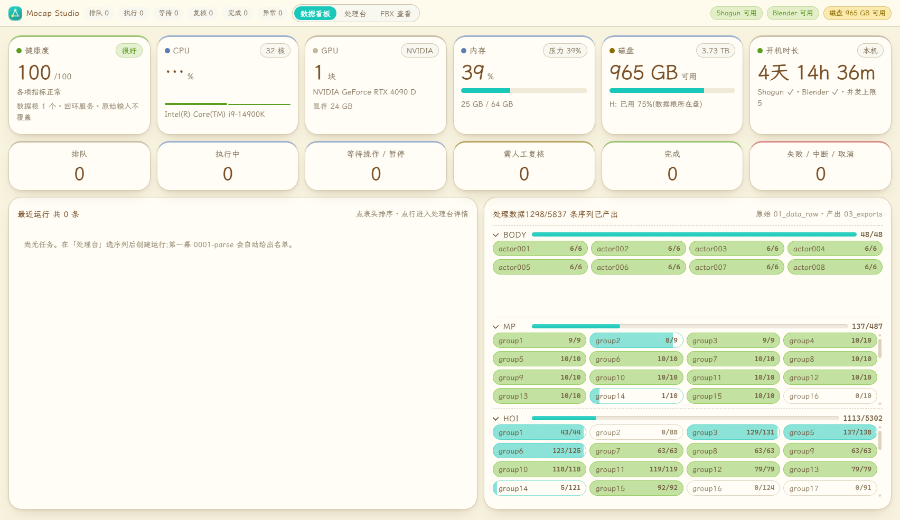
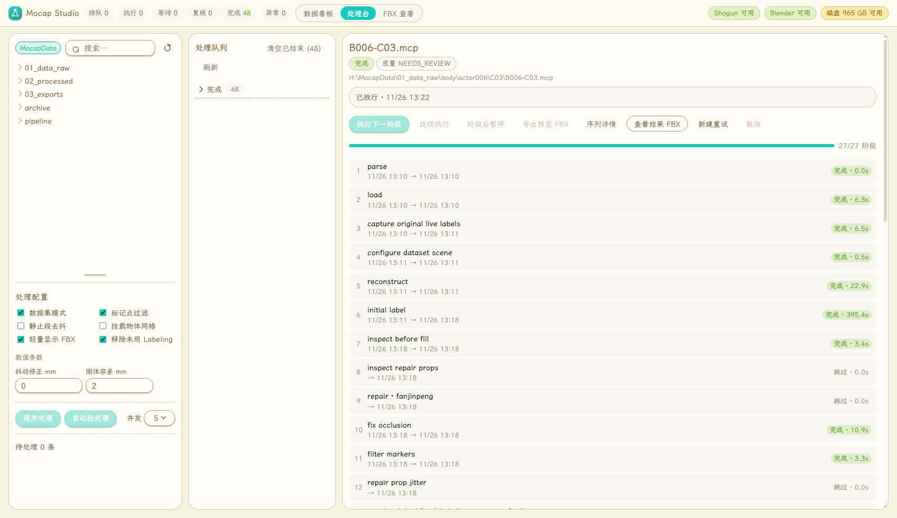
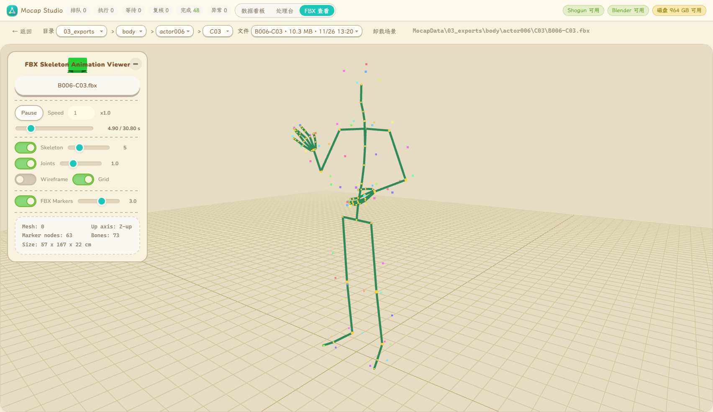

<div align="center">

# △ Mocap Studio

**Vicon Shogun 动捕批处理工作台** —— 浏览器里的序列管理、自动化解算管线、质量门控与 3D 验收工具。

单进程回环服务（Python 标准库，零 Web 框架）· React 前端 · Three.js 查看器 · Animal Crossing 风皮肤

</div>

## 界面

**数据看板** —— 按数据集族（BODY / MP / HOI）→ 演员/分组的完成进度色块，队列统计与机器状态实时刷新：



**处理台** —— 左：数据浏览器（目录树 / `@` 跨根搜索 / 整目录入队）；中：按状态自动分组的处理队列（每序列只保留一个任务）；右：运行详情、26 阶段时间线、质量报告与放行：



**FBX 查看器** —— 级联定位 03_exports 净空产物，骨架 + marker 播放验收（marker 尺寸、骨骼粗细可调），从任务跳转自动定位文件：



## 为什么做这个

Vicon Shogun Post 的官方批处理只有命令行 HSL 与一次性脚本：几百条 take 的解算、修复、逐人导出、质检靠人肉盯非常痛苦。Mocap Studio 把 4DHOI 项目沉淀的 Shogun 自动化引擎包成一台**看得见的流水线**：

- 每条 take 自动跑完 26 个真实阶段（parse → 配置 → 重建 → 标记修复 → 解算 → 逐人导出 → 净空裁剪），进度、日志、报告、产物全部可回溯；
- 质量门控自动分流：覆盖度、刚体几何、骨骼动画、live-label 一致性——**过不了的门控不会伪装成成功**，交给人复核；复核没问题一键**放行**（留审计记录）；
- 处理策略按数据族自动适配：`HOI`（人+物交互）保留并处理物体；`MP` / `BODY`（人体专用）在 configure 阶段就删除场景内全部刚体，导出只留人物骨架与本人 marker。

## 核心能力

| 能力 | 说明 |
| --- | --- |
| 自动批处理 / 逐步执行 | 并发 1–8 个真实 Shogun PostCL 会话；逐步模式在每个阶段边界暂停，可导出中间预览 FBX 检查 |
| 数据族识别 | `0001-parse` 只读解析 MCP/FBX 出人物·刚体·marker 名单，自动标注 HOI / MP / BODY |
| 缺席容忍 | 单人 take 里 0 数据或覆盖率 <1% 的"误入镜"主体自动剔除，不产生复核噪声 |
| 静止段去抖（可选） | 净位移小 + 二阶差分大 → 判定为抖但不动，零相位 Butterworth 低通按通道处理（骨骼旋转/平移、marker 轨迹），运动窗口逐字节不动 |
| 挂钟拍摄时间 | 从 MCP 提取 Live 打开时刻 + 135MHz 时码发生器 tick，给出 take 首/尾帧的绝对挂钟时间，与章鱼时码器同步的 RGB 相机直接对齐 |
| 归档契约 | `02_processed` 完整工作档（fbx/vdf/vsk）· `03_exports` 每序列**一个**直接可用净空 FBX · 永不覆盖原始输入 |
| 队列不变式 | 重跑开始即清除同序列旧终态任务；每序列队列中永远只有一条 |
| 3D 验收 | 内置查看器（three.js FBXLoader 离线 vendored），marker/骨骼渲染与播放，支持覆盖度与逐人序列 |
| 质量报告 | 每 run 结构化 report.json：阶段时间线、逐主体 before/after 覆盖度、几何核验、复核结论汇总 |

## 架构

```
┌─────────────────────────────┐      ┌──────────────────────────────┐
│ 浏览器 (React, animal-ui)    │ HTTP │ server/app_server.py         │
│  数据看板 · 处理台 · FBX 查看 │◄────►│  /api/processing/*  回环:8787│
│  viewer/fbx_viewer.html     │      │  JobManager(web_manager)     │
└─────────────────────────────┘      │  Worker 子进程(web_worker)    │
                                     └──────────┬───────────────────┘
                                                │ subprocess + SDK
                                                ▼
                              ShogunPostCL.exe ×N (1–8 并发, 独占会话端口)
                                                │
        ┌───────────────────────────────────────┼─────────────────────────┐
        ▼                                       ▼                         ▼
 01_data_raw (只读输入)               jobs\<id>\ (工作现场)      02_processed / 03_exports
```

- **处理引擎不在本仓库**：解算/修复/裁剪引擎（`pipeline_processing.py`、`pipeline_session.py`、`fbx_lightweight.py` 等）由 4DHOI 项目 `scripts/shogun/` 维护，通过 `--scripts` 指向；本仓库承载 Web 服务、队列管理、前端与查看器，以及只读解析模块 `sequence_inspect.py`。
- `server/`：`app_server.py`（静态站点 + REST 入口）、`web_manager.py`（队列、目录树、inspect、放行、归档路由）、`web_worker.py`（每任务一个子进程，检查点/断点审计）。
- `workbench/`：React 前端（Vite，构建产物 `dist/` 由服务直接静态托管）。
- `viewer/`：独立 FBX 查看器页（three.js vendored，离线可用）。

## 快速开始（Windows）

前置：Python 3.11+（服务与 worker）、Node 18+（仅构建前端）、Vicon Shogun Post 1.13/1.21（ShogunPostCL.exe）、可选 Blender（挂载物体网格）。

```powershell
git clone <repo-url> && cd MocapStudio
.\启动MocapStudio.ps1 -Build        # 构建前端 + 启动，浏览器打开 http://127.0.0.1:8787/
# 常用参数:-Port -MaxWorkers -DataRoot H:\MocapData -JobsDir H:\MocapData\jobs
#          -Scripts <4DHOI>\scripts\shogun  -Repo <4DHOI>
```

数据目录契约（`DataRoot` 下）：

```
01_data_raw\      原始 take(groupN\HOI|MP\take\X.mcp|vdf · body\actorXXX\take\X.mcp)
02_processed\     完整工作档(镜像 01 结构:fbx/vdf/vsk)
03_exports\       直接可用净空 FBX(每 take 一个)
jobs\             工作现场(每任务目录:report.json/processing.log/state.json/检查点)
```

## 质量门控与放行

`NEEDS_REVIEW` 只意味着"机器不能替你签字"：partial 覆盖、`labeling_skeleton_animation_partial`、刚体/分段几何漂移（`calibrated_segment_geometry`）、live-label 位置分歧（`original_live_label_position_disagreement`）等。处理台里逐问题行可定位来源；在查看器确认没问题后点「**放行**」→ 状态转完成、`quality.usable=true` 并记录 `scope=approved_override` + 备注时间（审计可查）。失败/需复核任务的产物、日志、检查点全部保留，一键「新建重试」。

## API 摘要（回环 + CSRF）

```
GET  /api/processing/config | jobs | jobs/<id> | jobs/<id>/report | jobs/<id>/logs
POST /api/processing/jobs {paths,mode,options} | jobs/<id>/actions {action:step|run|pause|preview|retry|cancel|approve}
GET  /api/processing/tree | browse | find | inspect | outputs | dataset-progress | metrics
POST /api/processing/jobs/<id>/delete | jobs/clear-finished | config {max_workers}
```

写操作要求同源 + `X-Mocap-Token`；静态只暴露 `workbench/dist` 与 `viewer/`。

## 开发

```powershell
# 前端
cd workbench && npm install && npm run dev      # 或 ..\启动MocapStudio.ps1 -Build
npx tsc --noEmit                                 # 类型检查(严格模式)
# 服务与引擎侧单测
python -m unittest discover -s server            # app_server 行为测试
python -m unittest discover -s <4DHOI>\scripts\shogun   # 引擎回归(600+ 项)
```

## 文档

- [docs/changelog-legacy.md](docs/changelog-legacy.md) —— 完整演进/迁移记录（按日期）
- [docs/MocapWorkbench-plan-2025-11.md](docs/MocapWorkbench-plan-2025-11.md) —— 早期 UI 蓝图存档

## License

暂未指定。
